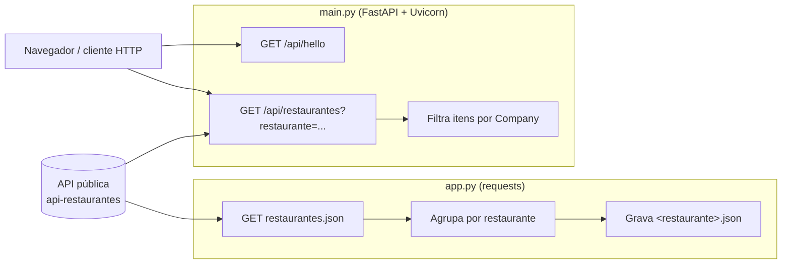

# OO Sabores Express

Projeto de estudo (Alura – Carreira Python, Nível 1) que trabalha com consumo e criação de APIs em Python:

- **`app.py`**: consome uma API pública de restaurantes e gera um arquivo JSON com o cardápio de cada restaurante.
- **`main.py`**: expõe uma API web com **FastAPI**, servida pelo **Uvicorn**, que consulta a mesma API pública e devolve o cardápio de um restaurante informado na requisição.

---

## Estrutura de pastas

```text
OO-SABORES-EXPRESS/
├── app.py               # Script que consome a API de restaurantes e gera os JSONs
├── main.py              # API FastAPI (endpoints /api/hello e /api/restaurantes)
├── requirements.txt     # Dependências do projeto
├── Burger King.json     # Cardápios gerados por app.py (um arquivo por restaurante)
├── KFC.json
├── McDonald’s.json
├── Pizza Hut.json
├── Taco Bell.json
└── Wendy’s.json
```

---

## Arquitetura

O projeto tem dois componentes independentes:

| Componente | Arquivo | Responsabilidade |
|---|---|---|
| **Cliente de API** | `app.py` | Faz `GET` em `https://guilhermeonrails.github.io/api-restaurantes/restaurantes.json` com `requests`, agrupa os itens por restaurante (`Company`) e grava `<restaurante>.json` com `item`, `price` e `description`. |
| **Servidor de API** | `main.py` | Cria a aplicação `FastAPI` (`app`) e publica as rotas HTTP. A rota `/api/restaurantes` faz `GET` na mesma API pública a cada requisição e filtra os itens pelo restaurante recebido no parâmetro `restaurante`. |



### Endpoints

| Método | Rota | Resposta |
|---|---|---|
| `GET` | `/api/hello` | `[{"name": "Empanadas"}, {"name": "Arepa"}]` |
| `GET` | `/api/restaurantes` | `{"Dados": [...]}` — todos os itens da API pública, sem filtro |
| `GET` | `/api/restaurantes?restaurante=<nome>` | `{"Restaurante": "<nome>", "Cardapio": [{"item": ..., "price": ..., "description": ...}, ...]}` |
| `GET` | `/docs` | Documentação interativa (Swagger UI) gerada pelo FastAPI |
| `GET` | `/redoc` | Documentação alternativa (ReDoc) |

#### `/api/restaurantes`

- Parâmetro de query **opcional**: `restaurante` — nome exato do restaurante, conforme o campo `Company` da API (ex.: `KFC`, `Burger King`, `McDonald’s`). Sem ele, a rota retorna todos os dados da API em `{"Dados": [...]}`.
- Se o nome não existir, retorna `Cardapio` como lista vazia.
- Se a API pública falhar, retorna `{"Erro": "<status_code> - <texto da resposta>"}`.

Exemplo:

```bash
curl "http://localhost:8000/api/restaurantes?restaurante=KFC"
```

---

## Pacotes necessários

Principais dependências (versões fixadas em [requirements.txt](requirements.txt)):

| Pacote | Uso |
|---|---|
| `fastapi` | Framework para criação da API |
| `uvicorn` | Servidor ASGI que executa a aplicação FastAPI |
| `requests` | Requisições HTTP à API de restaurantes (`app.py` e `main.py`) |
| `pydantic` | Validação de dados (dependência do FastAPI) |
| `starlette` | Base web do FastAPI |

### Instalação

```bash
# Criar e ativar o ambiente virtual
python -m venv .venv
source .venv/bin/activate        # Linux/macOS
# .venv\Scripts\activate         # Windows

# Instalar as dependências
pip install -r requirements.txt
```

---

## Como executar

### Gerar os arquivos JSON dos restaurantes

```bash
python app.py
```

### Iniciar o serviço da API (Uvicorn)

```bash
uvicorn main:app --reload --host=0.0.0.0
```

- `main:app` → módulo `main.py`, objeto `app` (instância do FastAPI).
- `--reload` → reinicia o servidor automaticamente ao alterar o código (uso em desenvolvimento).
- `--host=0.0.0.0` → escuta em todas as interfaces de rede, permitindo acesso a partir de outras máquinas da rede (não apenas `localhost`).

Por padrão o serviço sobe na porta `8000` (altere com `--port=<porta>`). Acesse:

- http://localhost:8000/api/hello
- http://localhost:8000/api/restaurantes?restaurante=KFC
- http://localhost:8000/docs
- De outra máquina: `http://<IP-da-máquina>:8000/api/hello`

> Se o acesso externo não funcionar, verifique se a porta 8000 está liberada no firewall (ex.: `sudo firewall-cmd --add-port=8000/tcp` no Fedora).
