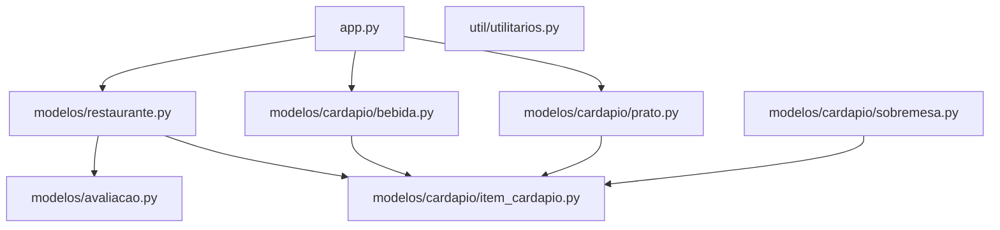
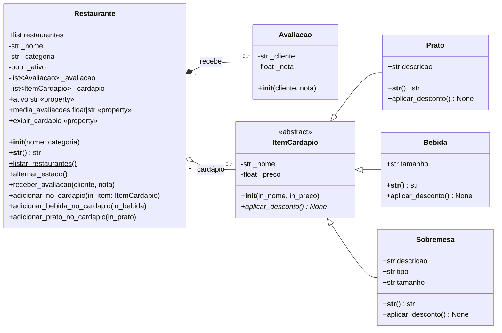
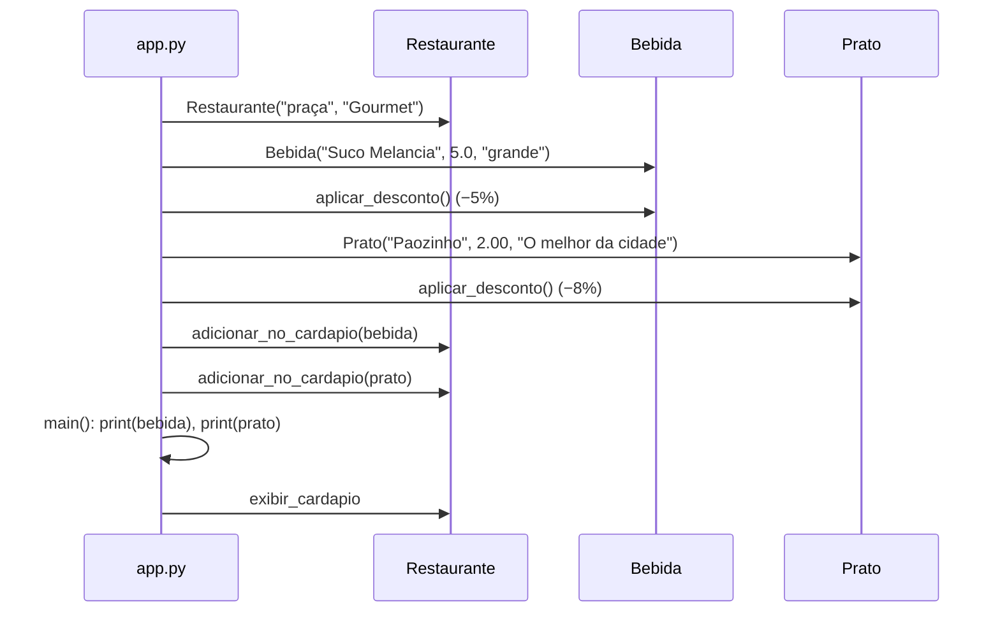

# Sabor Express

Aplicação em Python, orientada a objetos, para gerenciar as atividades de restaurantes: cadastro de restaurantes, controle de status (ativo/inativo), avaliações de clientes e montagem de cardápio com pratos, bebidas e sobremesas.

---

## Sumário

- [Estrutura de pastas](#estrutura-de-pastas)
- [Arquitetura](#arquitetura)
- [Diagrama de classes](#diagrama-de-classes)
- [Descrição das classes](#descrição-das-classes)
- [Relacionamentos](#relacionamentos)
- [Fluxo de execução](#fluxo-de-execução)
- [Como executar](#como-executar)
- [Qualidade de código](#qualidade-de-código)
- [Pontos de atenção](#pontos-de-atenção)

---

## Estrutura de pastas

```text
SABOR-EXPRESS/
├── app.py                        # Ponto de entrada da aplicação
├── modelos/                      # Camada de domínio (entidades)
│   ├── restaurante.py            # Classe Restaurante
│   ├── avaliacao.py              # Classe Avaliacao
│   └── cardapio/                 # Subdomínio do cardápio
│       ├── item_cardapio.py      # Classe abstrata ItemCardapio
│       ├── prato.py              # Classe Prato
│       ├── bebida.py             # Classe Bebida
│       └── sobremesa.py          # Classe Sobremesa
└── util/
    └── utilitarios.py            # Funções utilitárias genéricas
```

---

## Arquitetura

O projeto segue uma organização em camadas simples:

| Camada | Local | Responsabilidade |
|---|---|---|
| **Aplicação** | `app.py` | Instancia os objetos de domínio, monta o cardápio e exibe o resultado. |
| **Domínio** | `modelos/` | Regras de negócio: restaurante, avaliações e itens do cardápio. |
| **Subdomínio Cardápio** | `modelos/cardapio/` | Hierarquia de itens vendáveis, baseada em uma classe abstrata. |
| **Utilitários** | `util/` | Funções de apoio (geração de dados aleatórios, entrada validada, formatação). Independente do domínio. |



> O módulo `util/utilitarios.py` ainda não é utilizado pelas classes de domínio; está disponível para uso futuro (ex.: gerar nomes de clientes e notas aleatórias para testes).

### Conceitos de POO aplicados

- **Abstração**: `ItemCardapio` é uma classe abstrata (`ABC`) que define o contrato `aplicar_desconto()`.
- **Herança**: `Prato`, `Bebida` e `Sobremesa` herdam de `ItemCardapio`.
- **Polimorfismo**: cada item implementa `aplicar_desconto()` com um percentual próprio.
- **Encapsulamento**: atributos internos usam o prefixo `_` (ex.: `_nome`, `_preco`, `_ativo`) e são expostos via `@property` quando necessário.
- **Composição**: `Restaurante` contém uma lista de `Avaliacao` e uma lista de `ItemCardapio`.
- **Atributo e método de classe**: `Restaurante.restaurantes` registra todas as instâncias; `listar_restaurantes()` é um `@classmethod`.

---

## Diagrama de classes



---

## Descrição das classes

### `Restaurante` — `modelos/restaurante.py`

Entidade central do sistema.

| Membro | Tipo | Descrição |
|---|---|---|
| `restaurantes` | atributo de classe (`ClassVar`) | Lista com todas as instâncias criadas (registro automático no `__init__`). |
| `_nome` | atributo | Nome do restaurante, normalizado com `title()`. |
| `_categoria` | atributo | Categoria, normalizada com `upper()`. |
| `_ativo` | atributo | Status do restaurante; inicia como `False`. |
| `_avaliacao` | atributo | Lista de objetos `Avaliacao`. |
| `_cardapio` | atributo | Lista de objetos `ItemCardapio`. |
| `listar_restaurantes()` | `@classmethod` | Imprime tabela com nome, categoria, média e status de todos os restaurantes. |
| `ativo` | `@property` | Retorna `⌧` (ativo) ou `☐` (inativo). |
| `alternar_estado()` | método | Inverte o valor de `_ativo`. |
| `receber_avaliacao(cliente, nota)` | método | Cria uma `Avaliacao` se `0 < nota <= 5`. |
| `media_avaliacoes` | `@property` | Média das notas arredondada a 1 casa, ou `'-'` se não houver avaliações. |
| `adicionar_no_cardapio(item)` | método | Adiciona qualquer `ItemCardapio` (valida com `isinstance`). |
| `adicionar_bebida_no_cardapio()` / `adicionar_prato_no_cardapio()` | métodos | Versões específicas anteriores, sem validação de tipo. |
| `exibir_cardapio` | `@property` | Imprime os itens do cardápio numerados, mostrando descrição (pratos) ou tamanho (bebidas). |

### `Avaliacao` — `modelos/avaliacao.py`

Representa a nota dada por um cliente a um restaurante. Guarda `_cliente` e `_nota`. Sua criação é controlada por `Restaurante.receber_avaliacao()`.

### `ItemCardapio` — `modelos/cardapio/item_cardapio.py`

Classe **abstrata** base de todos os itens do cardápio. Define os atributos comuns `_nome` e `_preco` e o método abstrato `aplicar_desconto()`, que obriga as subclasses a definirem sua política de desconto. Não pode ser instanciada diretamente.

### Subclasses de `ItemCardapio`

| Classe | Arquivo | Atributos próprios | Desconto aplicado |
|---|---|---|---|
| `Prato` | `cardapio/prato.py` | `descricao` | 8% |
| `Bebida` | `cardapio/bebida.py` | `tamanho` | 5% |
| `Sobremesa` | `cardapio/sobremesa.py` | `descricao`, `tipo`, `tamanho` | 15% |

Todas sobrescrevem `__str__()` para retornar o nome do item.

### Módulo `util/utilitarios.py`

Módulo de funções (sem classes), organizadas em grupos:

| Grupo | Funções |
|---|---|
| Geração de dados aleatórios | `gerar_nome`, `gerar_sobrenome`, `gerar_nome_completo`, `gerar_um_inteiro`, `gerar_um_decimal`, `gerar_tupla_com_inteiros`, `gerar_tupla_com_decimais` |
| Verificações numéricas | `is_inteiro_primo`, `is_intiero_par`, `is_inteiro` |
| Entrada validada (`input`) | `obter_racional`, `obter_racional_positivo`, `obter_racional_nao_netativo`, `obter_inteiro`, `obter_inteiro_positivo`, `obter_inteiro_nao_negativo`, `obter_uma_letra` |
| Diversos | `ordernar_dicit_por_valor`, `calcular_imc`, `imprimir_titulo`, `imprime_matriz` |

---

## Relacionamentos

| Origem | Destino | Tipo | Cardinalidade | Descrição |
|---|---|---|---|---|
| `Restaurante` | `Avaliacao` | Composição | 1 → 0..* | As avaliações são criadas pelo próprio restaurante e só existem dentro dele. |
| `Restaurante` | `ItemCardapio` | Agregação | 1 → 0..* | Os itens são criados fora e adicionados ao cardápio. |
| `Prato` | `ItemCardapio` | Herança | — | Prato é um item de cardápio. |
| `Bebida` | `ItemCardapio` | Herança | — | Bebida é um item de cardápio. |
| `Sobremesa` | `ItemCardapio` | Herança | — | Sobremesa é um item de cardápio. |

---

## Fluxo de execução

O `app.py` demonstra o uso das classes:



---

## Como executar

Requer **Python 3.9+** (o atributo de classe `restaurantes` é anotado com `ClassVar[list["Restaurante"]]`, sintaxe de genéricos nativos disponível a partir do 3.9).

A partir da raiz do projeto:

```bash
python app.py
```

Saída esperada:

```text
Suco Melancia
Paozinho
Cardápio do restaurante Praça
1.Nome Suco Melancia | Preço: R$ 4.75 | Tamanho: grande
2.Nome Paozinho | Preço: R$ 1.84 | Descricao: O melhor da cidade
```

---

## Qualidade de código

O código é verificado e formatado com o [Ruff](https://docs.astral.sh/ruff/). A partir da raiz do projeto:

```bash
ruff check .            # lint
ruff check --fix .      # lint com correções automáticas (ex.: ordenação de imports)
ruff format .           # formatação (estilo compatível com o Black)
ruff format --check .   # apenas verifica a formatação, sem alterar arquivos
```

Convenções resultantes da formatação: aspas duplas, espaços em torno de operadores e após `:` nas anotações de tipo, duas linhas em branco entre definições de nível superior e imports ordenados.

> Em `app.py`, a linha `restaurante_praca.exibir_cardapio` tem `# noqa: B018`: o Ruff a considera uma expressão sem efeito, mas ela aciona a property que imprime o cardápio (veja o item 1 dos [Pontos de atenção](#pontos-de-atenção)).

---

## Pontos de atenção

Observações identificadas na análise do código, úteis para evoluções futuras:

1. **`exibir_cardapio` como `@property`**: o método apenas imprime (efeito colateral) e é chamado sem parênteses. Seria mais idiomático como método comum (`exibir_cardapio()`), o que também dispensaria o `# noqa: B018` em `app.py`.
2. **Distinção de itens por `hasattr`**: `exibir_cardapio` usa `hasattr(item, 'descricao')` para decidir o formato. Como `Sobremesa` também possui `descricao`, ela é exibida como prato e seu `tamanho`/`tipo` não aparecem. Uma alternativa polimórfica seria cada subclasse implementar seu próprio `__str__` detalhado.
3. **Métodos redundantes**: `adicionar_bebida_no_cardapio` e `adicionar_prato_no_cardapio` foram substituídos por `adicionar_no_cardapio` e podem ser removidos.
4. **Acesso a atributos protegidos**: `Restaurante` lê `item._nome`, `item._preco` e `avaliacao._nota` diretamente; expor esses valores via `@property` reforçaria o encapsulamento.
5. **Assinatura de `Sobremesa`**: usa parâmetros `nome, preco, ...`, enquanto `Prato` e `Bebida` usam o padrão `in_nome, in_preco, ...`.
6. **Pacotes sem `__init__.py`**: `modelos/` e `modelos/cardapio/` funcionam como *namespace packages*; adicionar `__init__.py` torna a estrutura explícita.
