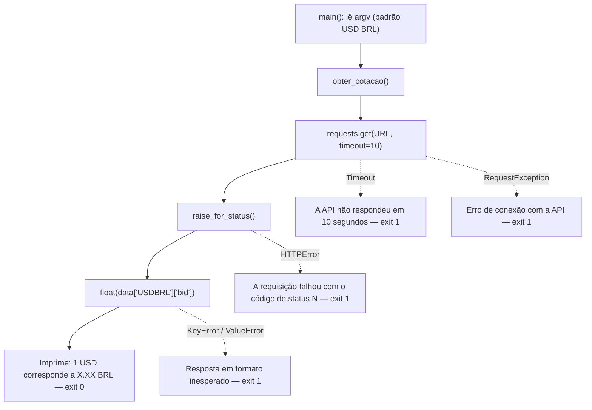

# Valor do Dólar

Script em Python que consulta a [AwesomeAPI de cotações](https://docs.awesomeapi.com.br/api-de-moedas) e mostra quanto vale 1 unidade de uma moeda em outra. Por padrão, dólar americano (USD) em reais (BRL).

```text
$ python leitura_api.py
1 USD corresponde a 5.95 BRL

$ python leitura_api.py EUR
1 EUR corresponde a 6.52 BRL
```

---

## Sumário

- [Estrutura de pastas](#estrutura-de-pastas)
- [Como funciona](#como-funciona)
- [Formato da resposta da API](#formato-da-resposta-da-api)
- [Módulo de utilitários](#módulo-de-utilitários)
- [Como executar](#como-executar)
- [Qualidade de código](#qualidade-de-código)
- [Histórico de correções](#histórico-de-correções)

---

## Estrutura de pastas

```text
VALOR_DO_DOLAR/
├── leitura_api.py      # Ponto de entrada: consulta a API e imprime a cotação
├── dados.json          # Exemplo de resposta da API (referência, não é lido pelo script)
├── requirements.txt    # Dependências (requests e suas dependências transitivas)
└── util/
    └── utilitarios.py  # Funções utilitárias genéricas (não usadas pelo script)
```

---

## Como funciona

[leitura_api.py](leitura_api.py) é dividido em duas funções:

| Função | Responsabilidade |
|---|---|
| `obter_cotacao(moeda="USD", moeda_destino="BRL") -> float` | Faz a requisição e devolve o `bid` como `float`. Não imprime nada; erros sobem como exceção. Pode ser importada por outros módulos. |
| `main() -> int` | Lê as moedas da linha de comando, chama `obter_cotacao`, trata os erros e imprime o resultado. Devolve o código de saída do processo (`0` sucesso, `1` erro). |



Passo a passo:

1. **Parâmetros** — o 1º argumento é a moeda de origem e o 2º a de destino; ambos são opcionais (`USD` e `BRL`) e aceitos em minúsculas.
2. **Requisição** — `GET https://economia.awesomeapi.com.br/last/{MOEDA}-{DESTINO}` com `timeout=10` segundos (`TIMEOUT_SEGUNDOS`), para o script não travar se a API não responder.
3. **Verificação do status** — `raise_for_status()` transforma qualquer status HTTP de erro (ex.: `404` para um par inexistente) em `requests.HTTPError`.
4. **Leitura do JSON** — a chave de primeiro nível é o par sem hífen (`USDBRL`). A API envia os valores como **texto**, por isso o campo `bid` (preço de compra) é convertido com `float()`.
5. **Saída** — o valor é formatado com duas casas decimais (`{cotacao:.2f}`).

### Tratamento de erros

| Situação | Exceção capturada | Mensagem |
|---|---|---|
| Status HTTP de erro | `requests.HTTPError` | `A requisição falhou com o código de status N` |
| API não respondeu a tempo | `requests.Timeout` | `A API não respondeu em 10 segundos.` |
| Sem internet, DNS, conexão recusada | `requests.RequestException` | `Erro de conexão com a API: ...` |
| JSON sem a chave esperada ou valor não numérico | `KeyError`, `ValueError` | `A resposta da API veio em um formato inesperado.` |

A ordem dos `except` importa: `HTTPError` e `Timeout` são subclasses de `RequestException` e por isso vêm antes.

---

## Formato da resposta da API

O arquivo [dados.json](dados.json) guarda uma resposta real da API, útil para consultar a estrutura sem fazer a requisição:

```json
{
  "USDBRL": {
    "code": "USD",
    "codein": "BRL",
    "name": "Dólar Americano/Real Brasileiro",
    "high": "5.9488",
    "low": "5.9292",
    "varBid": "0.0131",
    "pctChange": "0.2207",
    "bid": "5.9488",
    "ask": "5.9493",
    "timestamp": "1795198734",
    "create_date": "2026-11-20 15:18:54"
  }
}
```

| Campo | Significado |
|---|---|
| `code` / `codein` | Moeda de origem e de destino |
| `bid` | Preço de compra — **valor usado pelo script** |
| `ask` | Preço de venda |
| `high` / `low` | Máxima e mínima do dia |
| `varBid` / `pctChange` | Variação absoluta e percentual |
| `timestamp` / `create_date` | Momento da cotação (Unix e data legível) |

A chave de primeiro nível é o par sem hífen (`USDBRL`); `obter_cotacao` monta essa chave a partir dos parâmetros (ex.: `EUR`, `BRL` → `data["EURBRL"]`).

---

## Módulo de utilitários

[util/utilitarios.py](util/utilitarios.py) é uma biblioteca de funções de apoio reaproveitada entre os projetos do curso. O script de cotação **não importa** esse módulo.

| Grupo | Funções |
|---|---|
| Geração de dados aleatórios | `gerar_nome`, `gerar_sobrenome`, `gerar_nome_completo`, `gerar_um_inteiro`, `gerar_um_decimal`, `gerar_tupla_com_inteiros`, `gerar_tupla_com_decimais` |
| Verificações numéricas | `is_inteiro_primo`, `is_inteiro_par`, `is_inteiro` |
| Entrada validada (`input` em laço até o valor ser válido) | `obter_racional`, `obter_racional_positivo`, `obter_racional_nao_negativo`, `obter_inteiro`, `obter_inteiro_positivo`, `obter_inteiro_nao_negativo`, `obter_uma_letra` |
| Dicionários | `ordenar_dict_por_valor` |
| Cálculos | `calcular_imc` |
| Impressão formatada | `imprimir_titulo`, `imprime_matriz` |

---

## Como executar

Pré-requisitos: Python 3 e acesso à internet.

```bash
cd VALOR_DO_DOLAR

# cria e ativa o ambiente virtual
python -m venv .venv
source .venv/bin/activate      # Windows: .venv\Scripts\activate

# instala as dependências
pip install -r requirements.txt

# executa (USD → BRL)
python leitura_api.py

# outras moedas: origem e destino
python leitura_api.py EUR
python leitura_api.py BTC USD
```

---

## Qualidade de código

O código é verificado com o [Ruff](https://docs.astral.sh/ruff/):

```bash
ruff check .        # lint
ruff format .       # formatação
```

Ajustes feitos no `util/utilitarios.py` para deixar o lint limpo:

- imports ordenados (`I001`);
- `tuple(map(lambda ...))` trocado por expressão geradora (`C417`);
- variável `qtd_linhas`, que não era usada, removida de `imprime_matriz` (`F841`);
- `if` de máximo trocado por `max()` (`PLR1730`);
- `sep=''` desnecessário removido do `print` (`FURB105`).

---

## Histórico de correções

Pontos de atenção da primeira versão, já corrigidos:

| Problema | Correção |
|---|---|
| `requests.get` sem timeout | `timeout=TIMEOUT_SEGUNDOS` (10 s) |
| Erros de rede não tratados | `try/except` para `HTTPError`, `Timeout`, `RequestException`, `KeyError`/`ValueError`, com código de saída `1` |
| Nome do arquivo com hífen (não importável) | `leitura-api.py` renomeado para `leitura_api.py`; lógica em `obter_cotacao()` e execução protegida por `if __name__ == "__main__"` |
| Moeda fixa no código | Moedas de origem e destino recebidas pela linha de comando |
| Erros de digitação em `utilitarios.py` | `is_intiero_par` → `is_inteiro_par`, `obter_racional_nao_netativo` → `obter_racional_nao_negativo`, `ordernar_dicit_por_valor` → `ordenar_dict_por_valor`; docstring do módulo passa a citar `is_inteiro_primo()`; mensagem "potivio" → "positivo" |
