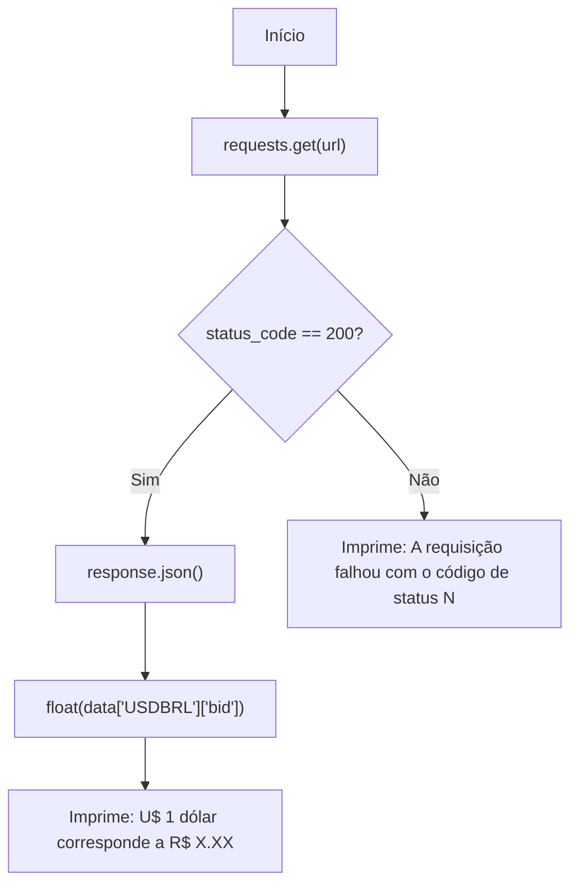

# Valor do Dólar

Script em Python que consulta a [AwesomeAPI de cotações](https://docs.awesomeapi.com.br/api-de-moedas) e mostra quanto vale 1 dólar americano (USD) em reais (BRL).

```text
$ python leitura-api.py
U$ 1 dólar corresponde a R$ 5.95
```

---

## Sumário

- [Estrutura de pastas](#estrutura-de-pastas)
- [Como funciona](#como-funciona)
- [Formato da resposta da API](#formato-da-resposta-da-api)
- [Módulo de utilitários](#módulo-de-utilitários)
- [Como executar](#como-executar)
- [Qualidade de código](#qualidade-de-código)
- [Pontos de atenção](#pontos-de-atenção)

---

## Estrutura de pastas

```text
VALOR_DO_DOLAR/
├── leitura-api.py      # Ponto de entrada: consulta a API e imprime a cotação
├── dados.json          # Exemplo de resposta da API (referência, não é lido pelo script)
├── requirements.txt    # Dependências (requests e suas dependências transitivas)
└── util/
    └── utilitarios.py  # Funções utilitárias genéricas (não usadas pelo script)
```

---

## Como funciona

[leitura-api.py](leitura-api.py) faz uma única requisição HTTP e trata dois casos:



Passo a passo:

1. **Requisição** — `GET https://economia.awesomeapi.com.br/last/USD-BRL`, que devolve a última cotação do par USD-BRL.
2. **Verificação do status** — só segue com o processamento se a API responder `200 OK`. Em qualquer outro caso, mostra o código HTTP recebido.
3. **Leitura do JSON** — `response.json()` transforma o corpo da resposta em um `dict`.
4. **Extração da cotação** — a API envia os valores como **texto**, por isso o campo `bid` (preço de compra) é convertido com `float()`.
5. **Saída** — a mensagem é montada com f-string e o valor é formatado com duas casas decimais (`{cotacao:.2f}`).

---

## Formato da resposta da API

O arquivo [dados.json](dados.json) guarda uma resposta real da API, útil para consultar a estrutura sem fazer a requisição:

```json
{
  "USDBRL": {
    "code": "USD",
    "codein": "BRL",
    "name": "Dólar Americano/Real Brasileiro",
    "high": "5.9488",
    "low": "5.9292",
    "varBid": "0.0131",
    "pctChange": "0.2207",
    "bid": "5.9488",
    "ask": "5.9493",
    "timestamp": "1795198734",
    "create_date": "2026-11-20 15:18:54"
  }
}
```

| Campo | Significado |
|---|---|
| `code` / `codein` | Moeda de origem e de destino |
| `bid` | Preço de compra — **valor usado pelo script** |
| `ask` | Preço de venda |
| `high` / `low` | Máxima e mínima do dia |
| `varBid` / `pctChange` | Variação absoluta e percentual |
| `timestamp` / `create_date` | Momento da cotação (Unix e data legível) |

A chave de primeiro nível é o par sem hífen (`USDBRL`). Para outra moeda, troque o par na URL e a chave na leitura (ex.: `EUR-BRL` → `data["EURBRL"]`).

---

## Módulo de utilitários

[util/utilitarios.py](util/utilitarios.py) é uma biblioteca de funções de apoio reaproveitada entre os projetos do curso. O script de cotação **não importa** esse módulo.

| Grupo | Funções |
|---|---|
| Geração de dados aleatórios | `gerar_nome`, `gerar_sobrenome`, `gerar_nome_completo`, `gerar_um_inteiro`, `gerar_um_decimal`, `gerar_tupla_com_inteiros`, `gerar_tupla_com_decimais` |
| Verificações numéricas | `is_inteiro_primo`, `is_intiero_par`, `is_inteiro` |
| Entrada validada (`input` em laço até o valor ser válido) | `obter_racional`, `obter_racional_positivo`, `obter_racional_nao_netativo`, `obter_inteiro`, `obter_inteiro_positivo`, `obter_inteiro_nao_negativo`, `obter_uma_letra` |
| Dicionários | `ordernar_dicit_por_valor` |
| Cálculos | `calcular_imc` |
| Impressão formatada | `imprimir_titulo`, `imprime_matriz` |

---

## Como executar

Pré-requisitos: Python 3 e acesso à internet.

```bash
cd VALOR_DO_DOLAR

# cria e ativa o ambiente virtual
python -m venv .venv
source .venv/bin/activate      # Windows: .venv\Scripts\activate

# instala as dependências
pip install -r requirements.txt

# executa
python leitura-api.py
```

---

## Qualidade de código

O código é verificado com o [Ruff](https://docs.astral.sh/ruff/):

```bash
ruff check .        # lint
ruff format .       # formatação
```

Ajustes feitos no `util/utilitarios.py` para deixar o lint limpo:

- imports ordenados (`I001`);
- `tuple(map(lambda ...))` trocado por expressão geradora (`C417`);
- variável `qtd_linhas`, que não era usada, removida de `imprime_matriz` (`F841`);
- `if` de máximo trocado por `max()` (`PLR1730`);
- `sep=''` desnecessário removido do `print` (`FURB105`).

---

## Pontos de atenção

- **Sem timeout** — `requests.get(url)` pode ficar esperando indefinidamente se a API não responder. Recomenda-se `requests.get(url, timeout=10)`.
- **Erros de rede não tratados** — falta de conexão ou DNS geram `requests.exceptions.ConnectionError` sem tratamento. Um `try/except requests.RequestException` deixaria a mensagem amigável.
- **Nome do arquivo com hífen** — `leitura-api.py` funciona como script, mas não pode ser importado como módulo (`import leitura-api` é inválido). Se for reaproveitado, renomeie para `leitura_api.py`.
- **Moeda fixa** — o par `USD-BRL` está fixo no código; poderia ser um parâmetro.
- **Nomes com erro de digitação em `utilitarios.py`** — `is_intiero_par`, `obter_racional_nao_netativo` e `ordernar_dicit_por_valor`. A docstring do módulo também cita `is_primo()`, mas a função se chama `is_inteiro_primo()`.
