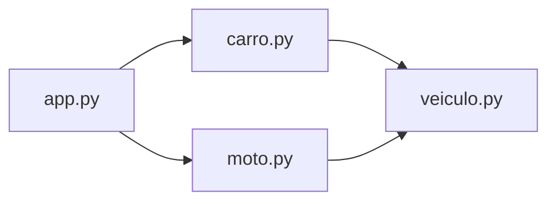
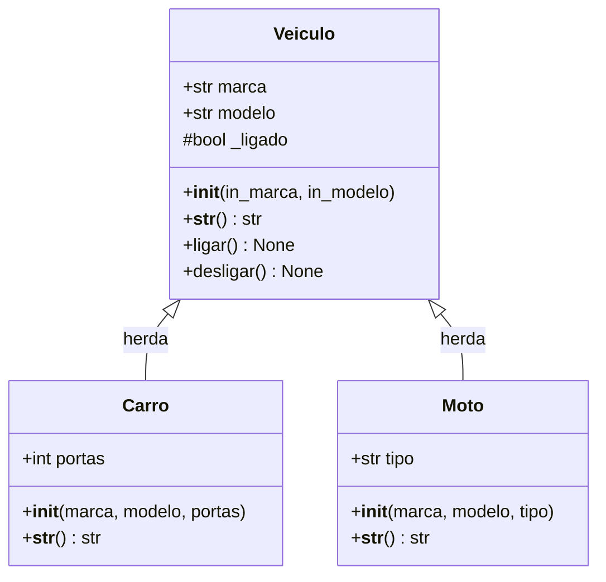
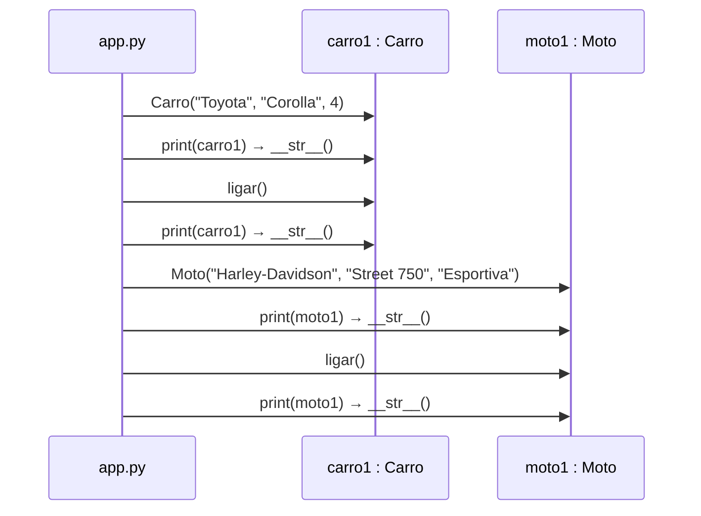

# VEICULOS

Projeto em Python para controlar as atividades de uma loja de veículos. Nesta fase ele traz o
**modelo de domínio**: uma hierarquia de classes que representa os veículos vendidos pela loja
(carros e motos), com um script de demonstração.

O projeto faz parte da trilha *Carreira Python – Nível 1 / Objetos e APIs* (Alura) e serve para
praticar **herança**, **sobrescrita de métodos**, **`super()`** e **encapsulamento**.

---

## Estrutura de arquivos

```
VEICULOS/
├── veiculo.py   # Classe base Veiculo (atributos e comportamentos comuns)
├── carro.py     # Classe Carro, especialização de Veiculo
├── moto.py      # Classe Moto, especialização de Veiculo
├── app.py       # Ponto de entrada: cria objetos e demonstra o uso
└── README.md
```

## Arquitetura

O projeto segue uma arquitetura simples em duas camadas:

| Camada | Arquivos | Responsabilidade |
|---|---|---|
| **Aplicação** | `app.py` | Ponto de entrada. Cria os veículos e exercita seus comportamentos. |
| **Domínio (modelo)** | `veiculo.py`, `carro.py`, `moto.py` | Define as entidades da loja e as regras de cada uma. |

Cada classe fica em um módulo próprio, e as dependências vão sempre **da especialização para a
generalização**: `carro.py` e `moto.py` importam `veiculo.py`, e `app.py` importa apenas as
classes concretas.



## Diagrama de classes



O relacionamento entre as classes é de **generalização/especialização** (herança "é um"):

- Um `Carro` **é um** `Veiculo`.
- Uma `Moto` **é um** `Veiculo`.

`Carro` e `Moto` não se conhecem; cada uma herda de `Veiculo` de forma independente.

## Descrição das classes

### `Veiculo` (`veiculo.py`): classe base

Reúne o que é comum a qualquer veículo da loja.

| Membro | Tipo | Descrição |
|---|---|---|
| `marca` | atributo público | Fabricante do veículo (ex.: "Toyota"). |
| `modelo` | atributo público | Modelo do veículo (ex.: "Corolla"). |
| `_ligado` | atributo protegido | Estado do motor. Começa como `False`. O prefixo `_` indica, por convenção, que ele não deve ser alterado diretamente de fora da classe. |
| `ligar()` | método | Muda `_ligado` para `True`. |
| `desligar()` | método | Muda `_ligado` para `False`. |
| `__str__()` | método especial | Retorna `"<marca> - <modelo> - <ligado/desligado>"`. |

### `Carro` (`carro.py`): especialização de `Veiculo`

| Membro | Descrição |
|---|---|
| `portas` | Quantidade de portas do carro. |
| `__init__` | Chama `super().__init__(marca, modelo)` para inicializar a parte comum e depois define `portas`. |
| `__str__` | **Sobrescreve** o método da base: reaproveita `super().__str__()` e acrescenta o número de portas. |

### `Moto` (`moto.py`): especialização de `Veiculo`

| Membro | Descrição |
|---|---|
| `tipo` | Categoria da moto (ex.: "Esportiva"). |
| `__init__` | Chama `super().__init__(marca, modelo)` e depois define `tipo`. |
| `__str__` | **Sobrescreve** o método da base: reaproveita `super().__str__()` e acrescenta o tipo. |

## Conceitos de POO aplicados

- **Herança**: `Carro` e `Moto` herdam atributos e métodos de `Veiculo`, sem duplicar código.
- **Reuso com `super()`**: as subclasses delegam à base a inicialização e a formatação comuns.
- **Sobrescrita (override)**: cada subclasse redefine `__str__` para mostrar seus próprios dados.
- **Polimorfismo**: `print()` chama o `__str__` certo para cada objeto, seja ele `Carro` ou `Moto`.
- **Encapsulamento por convenção**: o estado do motor (`_ligado`) só muda pelos métodos `ligar()` e `desligar()`.

## Fluxo de execução (`app.py`)



## Como executar

Requisito: **Python 3.14 ou superior**. Os métodos usam anotações que citam a própria classe
(ex.: `self: Veiculo`), e isso só funciona sem `from __future__ import annotations` a partir do
Python 3.14, que avalia anotações de forma adiada (PEP 649).

```bash
cd VEICULOS
python3 app.py
```

Saída esperada:

```
Toyota - Corolla - desligado - 4
Toyota - Corolla - ligado - 4
Harley-Davidson - Street 750 - desligado - Esportiva
Harley-Davidson - Street 750 - ligado - Esportiva
```

## Como estender

Para adicionar um novo tipo de veículo (ex.: `Caminhao`):

1. Crie `caminhao.py` com `class Caminhao(Veiculo)`.
2. No `__init__`, chame `super().__init__(marca, modelo)` e defina os atributos próprios (ex.: `capacidade_carga`).
3. Sobrescreva `__str__` reaproveitando `super().__str__()`.
4. Importe e use a nova classe em `app.py`.

Próximos passos naturais para a loja: uma classe `Loja`/`Estoque` que **agregue** vários
`Veiculo` (relação "tem um"), além de atributos comerciais como preço, ano e status de venda.
