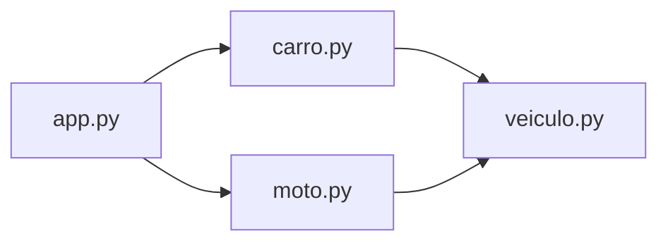
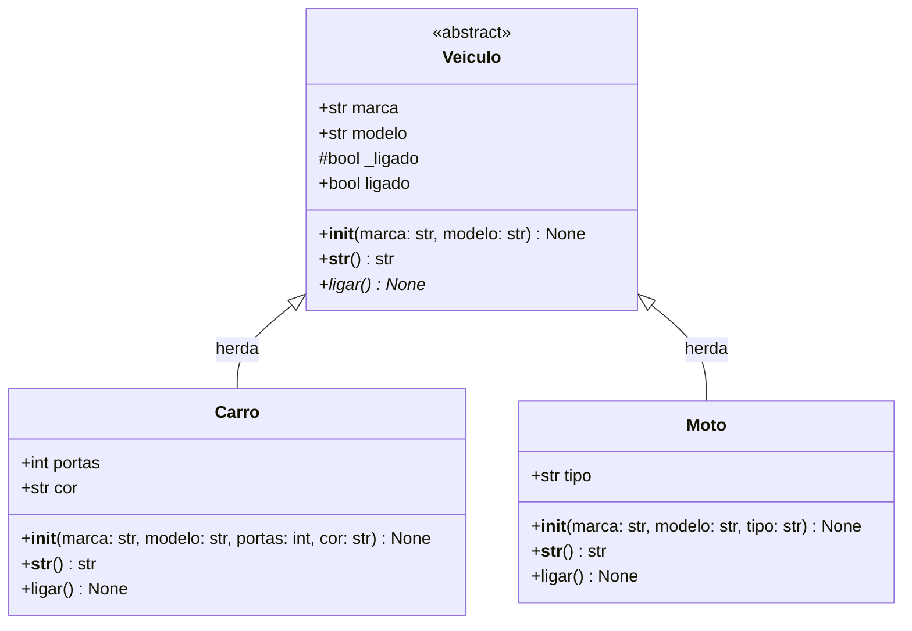
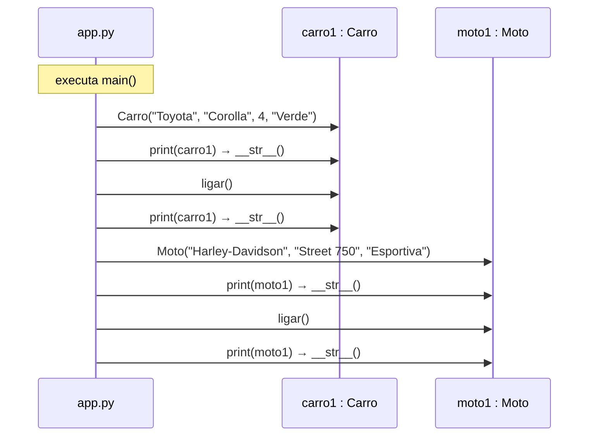

# VEICULOS

Projeto em Python para controlar as atividades de uma loja de veículos. Nesta fase ele traz o
**modelo de domínio**: uma hierarquia de classes que representa os veículos vendidos pela loja
(carros e motos), com um script de demonstração.

O projeto faz parte da trilha *Carreira Python – Nível 1 / Objetos e APIs* (Alura) e serve para
praticar **herança**, **classes abstratas**, **sobrescrita de métodos**, **`super()`** e
**encapsulamento com properties**.

---

## Estrutura de arquivos

```
VEICULOS/
├── veiculo.py   # Classe base abstrata Veiculo (atributos e comportamentos comuns)
├── carro.py     # Classe Carro, especialização de Veiculo
├── moto.py      # Classe Moto, especialização de Veiculo
├── app.py       # Ponto de entrada: função main() que cria objetos e demonstra o uso
├── prompts.txt  # Anotações dos prompts usados para gerar a documentação
└── README.md
```

## Arquitetura

O projeto segue uma arquitetura simples em duas camadas:

| Camada | Arquivos | Responsabilidade |
|---|---|---|
| **Aplicação** | `app.py` | Ponto de entrada. A função `main()` cria os veículos e exercita seus comportamentos; ela só roda quando o arquivo é executado diretamente (`if __name__ == "__main__":`). |
| **Domínio (modelo)** | `veiculo.py`, `carro.py`, `moto.py` | Define as entidades da loja e as regras de cada uma. |

Cada classe fica em um módulo próprio, e as dependências vão sempre **da especialização para a
generalização**: `carro.py` e `moto.py` importam `veiculo.py`, e `app.py` importa apenas as
classes concretas.



## Diagrama de classes



O relacionamento entre as classes é de **generalização/especialização** (herança "é um"):

- Um `Carro` **é um** `Veiculo`.
- Uma `Moto` **é um** `Veiculo`.

`Carro` e `Moto` não se conhecem; cada uma herda de `Veiculo` de forma independente.

No diagrama, `<<abstract>>` marca `Veiculo` como classe abstrata e o `*` em `ligar()` indica um
método abstrato, que cada subclasse precisa implementar.

## Descrição das classes

### `Veiculo` (`veiculo.py`): classe base abstrata

Reúne o que é comum a qualquer veículo da loja. Ela herda de `ABC` (módulo `abc`) e declara
`ligar()` como `@abstractmethod`, então **não pode ser instanciada diretamente**:
`Veiculo("Toyota", "Corolla")` gera `TypeError`. Só as subclasses que implementam `ligar()` podem
ser instanciadas.

| Membro | Tipo | Descrição |
|---|---|---|
| `marca` | atributo público | Fabricante do veículo (ex.: "Toyota"). |
| `modelo` | atributo público | Modelo do veículo (ex.: "Corolla"). |
| `_ligado` | atributo protegido | Estado do motor. Começa como `False`. O prefixo `_` indica, por convenção, que ele não deve ser acessado diretamente de fora da classe. |
| `ligado` | property com setter | Lê o estado do motor (`carro.ligado`) e permite alterá-lo (`carro.ligado = True`). O setter valida o valor e gera `TypeError` se ele não for `bool`. |
| `ligar()` | método abstrato | Não tem implementação na base; cada subclasse define como o veículo é ligado. |
| `__str__()` | método especial | Retorna `"Marca: <marca>, Modelo: <modelo>, Status: <ligado/desligado>"`. |

### `Carro` (`carro.py`): especialização de `Veiculo`

| Membro | Descrição |
|---|---|
| `portas` | Quantidade de portas do carro. |
| `cor` | Cor do carro (ex.: "Verde"). |
| `__init__` | Chama `super().__init__(marca, modelo)` para inicializar a parte comum e depois define `portas` e `cor`. |
| `__str__` | **Sobrescreve** o método da base: reaproveita `super().__str__()` e acrescenta `" - Portas: <portas> - Cor: <cor>"`. |
| `ligar` | **Implementa** o método abstrato da base com `self.ligado = True`, passando pelo setter da property. |

### `Moto` (`moto.py`): especialização de `Veiculo`

| Membro | Descrição |
|---|---|
| `tipo` | Categoria da moto (ex.: "Esportiva"). |
| `__init__` | Chama `super().__init__(marca, modelo)` e depois define `tipo`. |
| `__str__` | **Sobrescreve** o método da base: reaproveita `super().__str__()` e acrescenta `" - Tipo: <tipo>"`. |
| `ligar` | **Implementa** o método abstrato da base com `self.ligado = True`. |

> **Por que `self.ligado` e não `super().ligado`?** O setter de uma property só funciona por meio
> do próprio objeto (`self`). `super().ligado = True` gera `AttributeError`, e
> `super().ligado(True)` gera `TypeError`, porque `super().ligado` devolve o valor `bool`, que não
> pode ser chamado como função. Como `Carro` e `Moto` herdam de `Veiculo`, `self.ligado = True`
> já encontra o setter definido na base.

## Conceitos de POO aplicados

- **Herança**: `Carro` e `Moto` herdam atributos e métodos de `Veiculo`, sem duplicar código.
- **Classe abstrata**: `Veiculo` herda de `ABC` e define `ligar()` como `@abstractmethod`,
  obrigando cada subclasse a implementá-lo.
- **Reuso com `super()`**: as subclasses delegam à base a inicialização e a formatação comuns.
- **Sobrescrita (override)**: cada subclasse redefine `__str__` para mostrar seus próprios dados e
  implementa `ligar()`.
- **Polimorfismo**: `print()` chama o `__str__` certo para cada objeto, seja ele `Carro` ou `Moto`.
- **Encapsulamento**: o estado do motor fica em `_ligado` (privado por convenção). O acesso passa pela
  property `ligado`, cujo setter valida o tipo antes de alterar o estado.

## Padrões de código

- **Type hints** em todos os parâmetros e retornos (ex.: `def ligar(self) -> None:`).
- **Docstrings** em todos os módulos, classes e métodos, no estilo Google (seções `Args:` e
  `Attributes:`), seguindo a PEP 257. Elas podem ser consultadas com `help()`:

  ```bash
  python3 -c "from carro import Carro; help(Carro)"
  ```

- **Formatação e lint** com o [Ruff](https://docs.astral.sh/ruff/), seguindo a PEP 8:

  ```bash
  pip install --user ruff   # instalação (uma vez)
  ruff format --diff .      # mostra o que mudaria, sem alterar
  ruff format .             # aplica a formatação
  ruff check .              # aponta problemas de código
  ruff check --fix .        # corrige automaticamente o que for seguro
  ```

## Fluxo de execução (`app.py`)



## Como executar

Requisito: **Python 3** (não há dependências externas).

```bash
cd VEICULOS
python3 app.py
```

Saída esperada:

```
Marca: Toyota, Modelo: Corolla, Status: desligado - Portas: 4 - Cor: Verde
Marca: Toyota, Modelo: Corolla, Status: ligado - Portas: 4 - Cor: Verde
Marca: Harley-Davidson, Modelo: Street 750, Status: desligado - Tipo: Esportiva
Marca: Harley-Davidson, Modelo: Street 750, Status: ligado - Tipo: Esportiva
```

## Como estender

Para adicionar um novo tipo de veículo (ex.: `Caminhao`):

1. Crie `caminhao.py` com `class Caminhao(Veiculo)`.
2. No `__init__`, chame `super().__init__(marca, modelo)` e defina os atributos próprios (ex.: `capacidade_carga`).
3. Implemente `ligar()` (obrigatório, pois é abstrato em `Veiculo`), usando `self.ligado = True`.
4. Sobrescreva `__str__` reaproveitando `super().__str__()`.
5. Mantenha o padrão do projeto: type hints, docstrings e `ruff format .`.
6. Importe e use a nova classe na função `main()` de `app.py`.

Próximos passos naturais para a loja: uma classe `Loja`/`Estoque` que **agregue** vários
`Veiculo` (relação "tem um"), além de atributos comerciais como preço, ano e status de venda.
