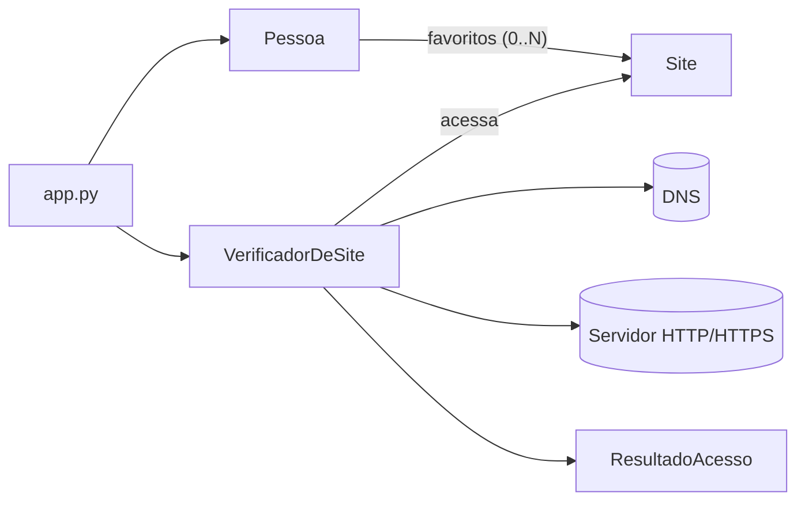
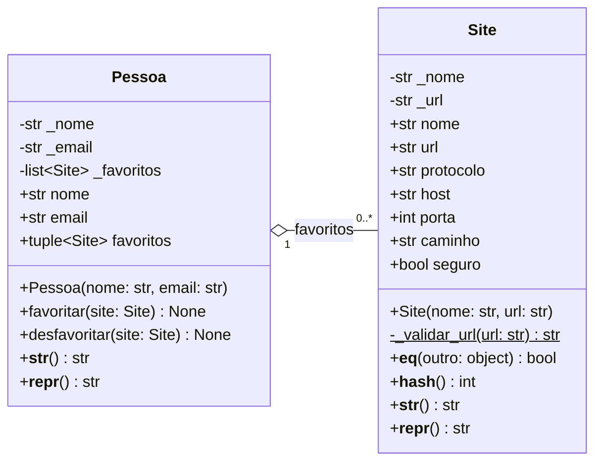

# REDES

Projeto de estudo (Alura – Carreira Python, Nível 1 – Redes e protocolos) que modela **pessoas** e **sites** com orientação a objetos e usa a rede de verdade para consultar os sites: resolve o **DNS** (nome → IP) e faz uma requisição **HTTP HEAD**, mostrando status, IP, porta e tempo de resposta.

Usa apenas a biblioteca padrão do Python (sem dependências externas).

---

## Estrutura de pastas

```text
REDES/
├── app.py                 # Ponto de entrada: monta os objetos e exibe os resultados
├── modelos/               # Domínio (regras de negócio, sem acesso à rede)
│   ├── __init__.py        # Exporta Pessoa e Site
│   ├── pessoa.py          # Classe Pessoa
│   └── site.py            # Classe Site
├── servicos/              # Infraestrutura (acesso à rede)
│   ├── __init__.py
│   └── verificador.py     # VerificadorDeSite e ResultadoAcesso
├── tests/
│   └── test_modelos.py    # Testes unitários dos modelos (unittest)
├── .gitignore
└── README.md
```

---

## Arquitetura

O código é dividido em camadas para que cada parte tenha uma única responsabilidade:

| Camada | Pasta | Responsabilidade |
|---|---|---|
| **Aplicação** | `app.py` | Cria os objetos, chama os serviços e imprime o resultado. |
| **Domínio** | `modelos/` | `Pessoa` e `Site`: dados, validações e regras. Não sabem nada de rede. |
| **Infraestrutura** | `servicos/` | `VerificadorDeSite`: DNS (`socket`) e HTTP (`urllib`). |



### Diagrama de classes



- `-` indica membro privado (convenção `_` do Python) e `+` membro público; os atributos públicos sem parênteses são `@property` somente leitura.
- `$` indica método estático (`@staticmethod`).
- A relação é uma **agregação**: uma `Pessoa` tem zero ou mais `Site`s favoritos, mas o `Site` existe independentemente dela.

### Classe `Site` (`modelos/site.py`)

| Membro | Descrição |
|---|---|
| `Site(nome, url)` | Valida nome não vazio e URL com protocolo `http`/`https` e host. |
| `nome`, `url` | Propriedades somente leitura. |
| `protocolo`, `host`, `porta`, `caminho` | Partes da URL (porta padrão: 80 para HTTP, 443 para HTTPS). |
| `seguro` | `True` se usa HTTPS (TLS). |
| `==` / `hash` | Dois sites são iguais quando têm a mesma URL. |

### Classe `Pessoa` (`modelos/pessoa.py`)

| Membro | Descrição |
|---|---|
| `Pessoa(nome, email)` | Valida nome não vazio e formato do e-mail (guardado em minúsculas). |
| `nome`, `email` | Propriedades somente leitura. |
| `favoritos` | Tupla (imutável) com os sites favoritos. |
| `favoritar(site)` | Adiciona um `Site`; recusa duplicados e objetos de outro tipo. |
| `desfavoritar(site)` | Remove um `Site` dos favoritos. |

### Serviço `VerificadorDeSite` (`servicos/verificador.py`)

`acessar(site)` resolve o IP com `socket.gethostbyname`, envia um `HEAD` com `urllib.request` e devolve um `ResultadoAcesso` (dataclass imutável) com `online`, `status_http`, `ip`, `tempo_ms` e `erro`. Falhas de rede não derrubam o programa: viram um resultado `OFFLINE`.

### Boas práticas aplicadas

- **Separação de responsabilidades**: modelos não fazem I/O; a rede fica isolada em `servicos/`.
- **Encapsulamento**: atributos privados (`_nome`) expostos por `@property` somente leitura; `favoritos` devolve uma cópia imutável.
- **Validação na criação**: objetos inválidos nunca chegam a existir (`ValueError` / `TypeError`).
- **Type hints** e **docstrings** em todo o código.
- **`__str__` / `__repr__` / `__eq__` / `__hash__`** implementados.
- **Testes unitários** sem depender de internet.
- **Sem dependências externas**: só biblioteca padrão.

> Observação: o arquivo `modelos/site.py` tem o mesmo nome do módulo `site` da biblioteca padrão. Por isso ele é sempre importado pelo pacote (`from modelos.site import Site` ou `from modelos import Site`) — não execute esse arquivo diretamente.

---

## Como executar

Requer Python 3.10+.

```bash
cd REDES
python3 app.py
```

Saída de exemplo:

```text
Favoritos de Marcus <marcus@exemplo.com>:

🔒 Python: protocolo=https host=www.python.org porta=443 caminho=/
🔒 Alura: protocolo=https host=www.alura.com.br porta=443 caminho=/
⚠️  Exemplo HTTP: protocolo=http host=example.com porta=80 caminho=/

Verificando acesso:

[200] Python -> 151.101.192.223:443 (176 ms)
[200] Alura -> 104.26.0.170:443 (223 ms)
[200] Exemplo HTTP -> 104.20.23.154:80 (153 ms)
```

## Como testar

```bash
python3 -m unittest -v
```

## Uso em código

```python
from modelos import Pessoa, Site
from servicos import VerificadorDeSite

ana = Pessoa("Ana", "ana@exemplo.com")
python = Site("Python", "https://www.python.org")
ana.favoritar(python)

print(python.host, python.porta, python.seguro)    # www.python.org 443 True
print(VerificadorDeSite().acessar(python))         # [200] Python -> ...:443 (... ms)
```
